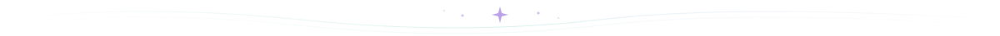
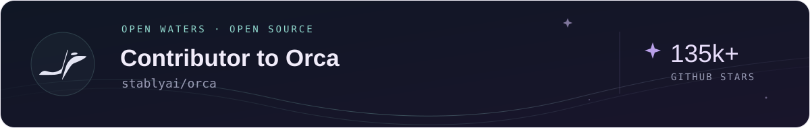

  

<samp>✧ &nbsp; below the surface &nbsp; · &nbsp; among the stars &nbsp; ✧</samp>

### ⊹ Below the Surface

I build desktop tools, web interfaces, and data experiments, with an interest in useful automation and thoughtful visuals.

### ✧ The Constellation

<samp>LANGUAGES &amp; FORMATS</samp>

<code>Python</code> <code>TypeScript</code> <code>JavaScript</code> <code>Rust</code> <code>SQL</code> <code>HTML</code> <code>CSS</code> <code>PowerShell</code> <code>Batch</code> <code>Markdown</code> <code>JSON</code> <code>YAML</code> <code>SVG</code>

<samp>INTERFACES &amp; DESKTOP</samp>

<code>React</code> <code>React Router</code> <code>Tauri</code> <code>Electron</code> <code>Vite</code> <code>Tailwind CSS</code> <code>Zustand</code> <code>Recharts</code> <code>Lucide</code> <code>Canvas</code> <code>Tkinter</code>

<samp>DATA, SERVERS &amp; MEDIA</samp>

<code>SQLite</code> <code>pandas</code> <code>NumPy</code> <code>Streamlit</code> <code>FastAPI</code> <code>Uvicorn</code> <code>HTTPX</code> <code>Pillow</code> <code>FFmpeg</code> <code>faster-whisper</code> <code>WebRTC</code> <code>PeerJS</code> <code>WebSockets</code> <code>sql.js</code>

<samp>BUILD, TEST &amp; SHIP</samp>

<code>Git</code> <code>GitHub</code> <code>GitHub CLI</code> <code>GitHub Actions</code> <code>Node.js</code> <code>npm</code> <code>Bun</code> <code>pnpm</code> <code>uv</code> <code>Playwright</code> <code>Vitest</code> <code>Testing Library</code> <code>unittest</code> <code>ESLint</code> <code>Prettier</code> <code>Oxlint</code> <code>CodeQL</code> <code>Dependabot</code>

<samp>EDITORS &amp; AI COMPANIONS</samp>

<code>Orca</code> <code>VS Code</code> <code>Codex</code> <code>Claude Code</code> <code>ChatGPT</code> <code>DeepSeek</code>

### ≋ Open Waters

<samp>⋆ &nbsp; ∞ &nbsp; ≋ &nbsp; ✧ &nbsp; ≋ &nbsp; ∞ &nbsp; ⋆</samp>

